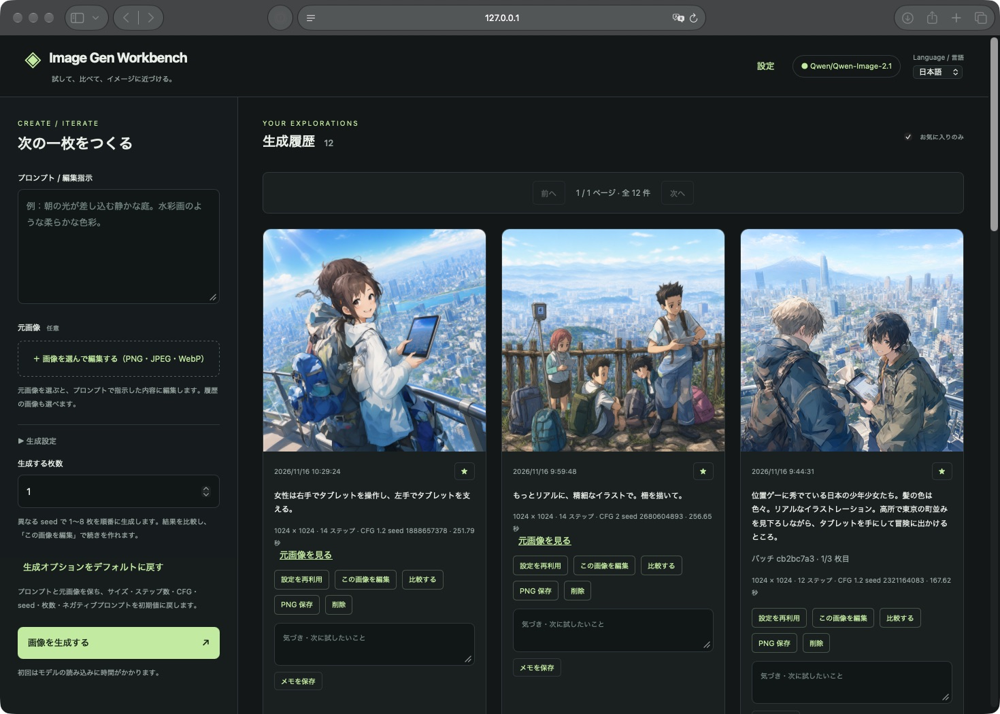

# Image Gen Workbench

A local image generation and editing workbench powered by **Qwen-Image-2.1**, with a Flask web interface. Generate an image, refine your prompt, edit an existing image, and compare results without losing your settings or history.



The Japanese interface with generated images filtered to favorites. The interface can be switched between English and Japanese.

## Features

- Generate 1–8 variations per submission with different seeds and choose a result to refine.
- Text-to-image generation and instruction-based image editing.
- Upload a source image or continue editing any generated image.
- Reuse prompts, seeds, and generation settings for iterative experiments.
- Compare two images side by side, mark favorites, and save notes.
- Background generation with progress, cancellation, and persistent history.
- Browse history 24 entries per page, including server-side favorites filtering.
- Download PNGs with generation settings embedded as metadata.
- Switch between **English and Japanese** without losing your current inputs.

## Quick start

Install **Python 3.12 or later** (Python 3.12 is recommended on macOS). Clone this repository, enter its directory, and run:

```sh
cd image-gen-workbench
python3.12 setup.py
./run
```

Your default browser opens automatically at **http://127.0.0.1:7860** once the server has bound its port. If the browser cannot be opened, visit that URL manually. Press **Ctrl+C** in the terminal to stop the server.

The setup script creates a project-local `.venv` and installs the application and model dependencies without modifying your system Python. Model weights are downloaded from Hugging Face on the first generation request. Installation and the initial model download require an internet connection. An existing Hugging Face model cache is reused automatically.

You can also activate the environment and use the installed command:

```sh
source .venv/bin/activate
image-gen-workbench
```

The `./run` launcher is intended for macOS and Linux. It uses the project directory as its working directory; the installed command uses your current directory unless you specify `--data-dir`.

### Hardware and precision

Qwen is a large model: allow substantial RAM/VRAM and disk space. The reference environment is an **Apple M2 Ultra with 128 GB of unified memory**. Quantization and CPU offloading are not currently implemented. Other hardware configurations have not been verified here.

Device selection defaults to MPS, then CUDA, then CPU. Automatic precision uses `bfloat16` on GPU and `float32` on CPU. GPU/OS support for `bfloat16` is required; CPU inference may be very slow. You can select the device and precision explicitly:

```sh
./run --version                      # Print the application version and exit
./run --no-browser                   # Start without opening a browser
./run --offline                      # Use cached weights only
./run --device mps --port 7861
./run --dtype float32                # Higher memory use
./run --model /path/to/qwen-model    # A QwenImage21Pipeline-compatible model
./run --data-dir /path/to/data
```

The model is loaded lazily and kept in memory for subsequent requests. The first request can take some time before step progress appears.

### Try the interface without a model

```sh
python3.12 setup.py --ui-only
./run --demo
```

Demo mode produces images labeled `DEMO`; it does **not** perform AI generation or editing. Run `python3.12 setup.py` later to install the model dependencies.

### Reuse dependencies from an existing environment

Optionally reference another virtual environment with the same Python major/minor version:

```sh
python3.12 setup.py --reuse-env /path/to/existing/venv
./run --offline
```

The existing environment is not modified. Moving, deleting, or updating it can affect this application. A standalone installation is recommended for portability.

## Language

Use the **Language / 言語** selector in the header to switch between **English** and **日本語**. The initial language follows your browser preference when supported, otherwise it defaults to English. Your selection is stored in a local, first-party cookie for one year and takes precedence on future visits.

Switching languages updates labels, history actions, progress, and application error messages immediately. Your prompt, negative prompt, selected source image, settings, comparison, and unsaved note drafts are preserved. Prompts and notes are never translated. Third-party model/library diagnostic messages and browser-native dialogs may use their own language. Command-line help and setup messages are in English.

Notifications appear in the upper-right corner of the viewport, including when scrolled down. Errors remain until dismissed or replaced by a subsequent message; ordinary notifications disappear after eight seconds. Use the × button to dismiss either type.

## Workflow

1. Enter a prompt, set **Number of images** (1–8), and select **Generate image**.
2. Select **Reuse settings** to retain the seed and settings while experimenting with the prompt. Leave the seed blank to generate a new random seed, which is recorded in the history.
3. Upload a source image or select **Edit this image** on a result. Describe the desired change, such as “change the background to sunset.” You can use the edited result as the source for another edit.
4. Select **Compare** on up to two results to view them side by side. Use favorites and notes to track promising results and ideas.
5. Select **Reset generation options** to restore 1024 × 1024, 12 steps, CFG 1, a random seed, one image, and an empty negative prompt. Your main prompt and selected source image stay unchanged.
6. Select **Save PNG** to download an image. The PNG `generation` text metadata also contains the prompt and generation settings, including the negative prompt and seed. Sharing the original PNG shares this metadata too; open **Settings** in the header and turn off **Include prompt and generation settings in PNG** before using **Save PNG** if it contains private information. The option is on by default to preserve the existing export behavior. Changes apply immediately and persist in this browser for this site (other browsers or ports have separate preferences). If browser storage is unavailable, the setting applies to the current page only and a warning is shown. This export removes all embedded metadata, including the prompt, negative prompt, seed, and other generation settings. The pixels, original stored PNG, and history remain unchanged.

**Use a different seed when editing a generated image.** Qwen-Image-2.1 can produce an oversaturated, over-sharpened near-copy and ignore edits when the starting noise used to create the reference is replayed (same random generator, seed, and output dimensions). **Edit this image** therefore clears the seed field to request a new random seed. **Reuse settings** retains the recorded seed for repeatable experiments. When uploading a previously generated image or entering a seed manually, avoid its original generation seed. See the [Qwen report](https://github.com/QwenLM/Qwen-Image-2.1/issues/9) and [Diffusers investigation](https://github.com/huggingface/diffusers/issues/14824). Changing seeds addresses this particular failure mode, not every possible editing artifact.

The Qwen-Image-2.1 image input supports instruction-based editing. This pipeline does not expose a conventional img2img `strength` parameter, so the interface does not provide one. Width and height must be multiples of 32 between 256 and 2048. Negative prompts are passed even when empty; CFG is enabled when its value is greater than 1. A fixed seed helps compare experiments, but results can vary across environments.

Each batch uses the same prompt, settings, and optional source image. Seeds start at your specified seed (or a random seed when blank) and increase by one, wrapping after 4294967295. Each result records its own seed and batch label and can be independently compared, downloaded, cancelled, or edited. Reusing settings or choosing an image to edit resets the image count to one; increase it again for more variations. The queue accepts at most 20 active images and rejects an entire batch if it would exceed that limit.

The default settings are **12 inference steps and CFG 1**. CFG 1 disables classifier-free guidance, so negative prompts have no effect at that setting.

For faster previews, try fewer inference steps (for example, compare 12, 20, and 28 with the same seed) or smaller dimensions. Fewer steps generally reduce denoising time but can reduce detail and prompt fidelity; these example counts are not quality guarantees. Loading, prompt processing, and image decoding add fixed overhead. Multiple images are generated sequentially to limit peak memory usage, so requesting more images increases total time rather than accelerating inference.

Jobs run sequentially. Cancellation is checked between generation steps; model loading and prompt processing cannot be stopped immediately. Jobs left unfinished when the server exits are marked as interrupted on the next launch, so you can reuse their settings and try again.

History is displayed newest first, with **24 entries per page** and Previous/Next controls. Polling retrieves only the current page. Favorites are filtered across the full history before pagination. Comparison selections and unsaved note drafts stay available when switching pages. Submitting a new generation returns to page one and clears the favorites filter so the queued results are visible. History remains live: new submissions can shift entries between pages.

`GET /api/jobs?page=1&favorites=0` returns `{items, total, page, pages, page_size}` instead of the previous full-history array. The page size is fixed at 24; `favorites=1` selects favorites only. Pages beyond the end are clamped to the last page. An empty history is page 1 of 1.

## Storage and local operation

- Job history: `data/history.sqlite3`
- Uploaded and generated images: `data/images/`
- Backups: stop the application and copy the entire `data/` directory.

Use **Delete** on a finished, failed, or cancelled history card to permanently remove its PNG, settings, and notes after confirmation. Active jobs cannot be deleted until generation/cancellation finishes. An image used as the source of another history entry is protected: delete its dependent entries first. Derived images are never deleted implicitly. Deleting a selected image also clears it from the source preview and comparison panel. If a page becomes empty, the history returns to the last available page.

**Delete unused uploads** removes uploaded source images that no history entry references, while keeping the currently selected source. It asks for confirmation and reports the number removed. Other open tabs may still hold selections of deleted uploads; re-upload them if needed. Cleanup works even when storage/record limits are reached. PNG disk space and record slots are reclaimed; SQLite may keep freed pages in its database file for reuse rather than immediately shrinking it. Interrupted deletions are reconciled on restart.

Local resource safeguards apply across all browser tabs:

- At most 20 outstanding images, including cancelled jobs until the worker drains them.
- At most 60 write requests per rolling minute (generation, uploads, annotation, and cancellation combined); excess requests receive HTTP 429. Read-only browsing and polling do not count.
- At most two uploads being processed concurrently; each request remains limited to 20 MiB and each image to 20 million pixels. Uploads accept only PNG, JPEG, and WebP, checked by file contents rather than the filename or MIME type. Other formats (including EPS) are rejected before decoding; accepted images are re-encoded as PNG.
- A default 10 GiB managed storage budget (images, history database and its journals), 1 GiB minimum free disk space, and 10,000 history/upload records combined. Queued outputs reserve a conservative storage allowance; actual capacity is checked again before saving. These are application safeguards, not an OS-level filesystem quota against unrelated processes.

Adjust storage limits at startup, for example:

```sh
./run --max-storage-gb 50 --min-free-gb 2 --max-records 50000
```

When a limit is reached, new work is refused with a localized message (HTTP 507 for storage/record limits). Already queued generation can fail if disk space decreases before its output is saved. Existing images remain readable; nothing is automatically deleted. Delete unwanted entries and unused uploads from the UI, raise the limits, or, with the app stopped, archive the whole data directory and start with a fresh `--data-dir`. Avoid deleting individual files behind the history database.

Responses disallow framing, restrict scripts and other resources to the app, disable MIME sniffing, omit referrer information, and request no browser caching. Cross-site write requests are rejected. Authentication and remote deployment remain out of scope: the server still binds only to loopback and uses the local Werkzeug server. Do not expose it directly to a network. Loopback binding does not isolate OS users: other users and processes on the same machine can read prompts and images, submit jobs, and delete history. Use it only on a trusted personal machine; forwarding the port also gives anyone who can reach the forwarded port this access.

Data is not deleted automatically. Inference runs on your computer; prompts and images are not sent to an external image-generation API. The server binds to loopback only. Only one server process can use a given data directory at a time.

## Development and tests

Run the Python tests without model weights or a GPU:

```sh
.venv/bin/python -m unittest discover -s tests -v
```

These cover generation and persistence, iterative editing, validation, failure recovery, cancellation, language selection, localized errors, and backward-compatible history display. Model substitutes verify application behavior, not image quality or hardware compatibility.

The frontend localization tests use the built-in Node.js test runner (Node.js is only needed for these tests):

```sh
node --test tests/i18n.test.cjs
```

An opt-in real-model smoke test uses MPS and cached weights to generate a 512 × 512 image and then edit it, both at 28 steps. Results are stored in `data/smoke/`:

```sh
.venv/bin/python tests/smoke_model.py
```

This generation/editing flow has been checked on the reference Mac. The original float16 configuration produced a numeric conversion warning in a low-step experiment, so the default GPU precision is bfloat16. You can explicitly choose `--dtype float16`. Numeric conversion failures are reported as failed jobs rather than successful images.

Translations are maintained in `image_gen_workbench/static/messages.json`, shared by the Python backend and browser interface. Keep message keys and interpolation placeholders aligned between languages.

## References

- [Qwen-Image-2.1 model](https://huggingface.co/Qwen/Qwen-Image-2.1)
- [Diffusers Qwen-Image-2.1 API](https://huggingface.co/docs/diffusers/en/api/pipelines/qwenimage21)

The initial implementation was based on a local Qwen script that loaded the model on CPU before moving it to MPS, using 28 inference steps and CFG 3.5.


## Inspect PNG generation metadata

From the project directory, run:

```sh
./inspect-png "/path/to/image.png"
```

This read-only utility prints the PNG's `generation` metadata as formatted JSON, including the prompt, negative prompt, seed, and other saved settings. Unicode prompts are displayed directly. It does not start the server or load a model and works with the UI-only installation.

If the field is missing (for example, after saving with **Include prompt and generation settings in PNG** turned off), it reports that no `generation` metadata was found. This does not rule out prompts in other applications' metadata fields. Invalid PNGs, unreadable files, or malformed JSON produce an error on stderr and exit status 1; successful inspection, including a missing field, exits with status 0.

After installation, `image-gen-inspect IMAGE.png` is also available in the virtual environment. Alternatively, use `.venv/bin/python -m image_gen_workbench.inspect_png IMAGE.png`. Quote paths containing spaces. The `inspect-png` wrapper resolves relative image paths from your current working directory.

## License

Image Gen Workbench is free software, licensed under the **GNU General Public License, version 3 or (at your option) any later version** (`GPL-3.0-or-later`). You may redistribute and modify it under those terms. It is provided without any warranty, including the implied warranties of merchantability or fitness for a particular purpose. See [LICENSE](LICENSE) for the full terms.

Third-party libraries and model weights retain their respective licenses; this license does not replace their terms. Generated images are not automatically covered by the application's GPL license merely because they were created with it.
